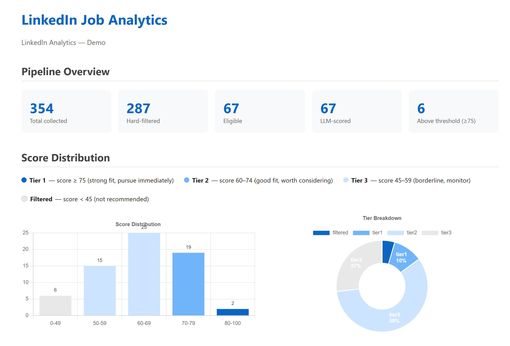
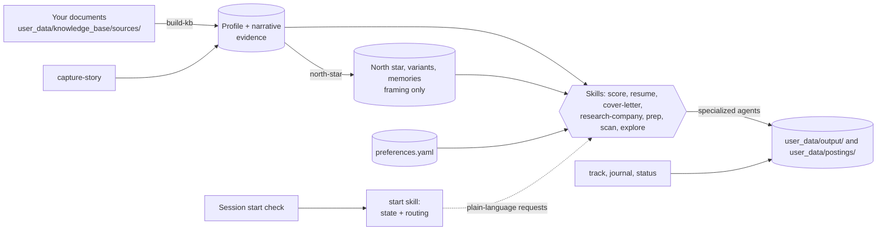

# CareerForge

Job searching manually is slow, inconsistent, and doesn't scale. CareerForge is a personal AI job search system powered by Claude Code. It automates the full search lifecycle — daily LinkedIn discovery with hard-filtering and LLM scoring, tailored resumes and cover letters generated in minutes, and deep interview preparation including company research and a personal story bank — all grounded in your verified career profile.

---

## Install

You need two free apps: **Claude Desktop** and **Git**. No terminal is required.

1. **Install Claude Desktop** from **https://claude.com/download**. CareerForge runs in its **Code** tab.
   > Claude.ai Projects (Cowork) is not supported: it can't run scripts or write files, and CareerForge needs both.
2. **Install Git** from **https://git-scm.com/downloads** (Windows: "Git for Windows"; on a Mac, typing `git` in Terminal offers to install it).
3. **Get CareerForge.** In Claude Desktop, open the **Code** tab, choose any folder (for example `Documents`), and say:
   > "Clone https://github.com/michaelgarcia/careerforge into a folder called CareerForge."

   Comfortable with a terminal? `git clone https://github.com/michaelgarcia/careerforge.git CareerForge` does the same.
4. **Start a new session in the `CareerForge` folder** and say **"hi"**. The first time, CareerForge offers a one-minute setup: it creates your private `user_data/` folder and installs the Python packages it needs (it installs Python too, with your OK, if it's missing).

---

## First-time setup (after installation)

In a session in the CareerForge folder, say:

> **"I'm ready to get started"**

Every session starts with a quick check of your workspace, so CareerForge already knows what's there: no documents yet, documents but no profile, a profile that's out of date, or active interviews. It walks you through building your profile from your resume and career documents, setting up your job search filters, and running your first scan, all in one conversation.

After setup, just talk to CareerForge in plain English. You never need to know a command:

- *"Find me jobs in machine learning"*
- *"I want to apply to [paste URL]"*
- *"I have an interview at AnyCompany next week"*
- *"What's my application status?"*
- *"Is my profile up to date?"*
- *"They made me an offer, is it any good?"*

See [docs/usage.md](docs/usage.md) for everything you can ask.

---

## What it looks like in practice

*354 jobs collected across 5 search scopes → 287 hard-filtered → 67 LLM-scored → **6 top matches surfaced automatically***

---

## Architecture

- **Evidence vs. framing.** Only your profile and narrative supply facts. The north star, resume variants and your memories decide emphasis and wording, never facts (`SOUL.md`).
- **Skills are the entry points.** You talk; the `start` skill routes. Interview-style work runs in your conversation, and heavy work runs in one of 8 specialized agents with its own context.
- **Shared rules live once.** `.claude/reference/` holds the scoring rubric, achievement format, output naming and more; every agent reads the same copy.

Details: [docs/usage.md](docs/usage.md).

---

## Slash Commands (optional)

You never need these: describe what you want in plain English and CareerForge routes it. They're shortcuts for when you already know what you want.

| Command | What it does |
|---------|-------------|
| `/build-kb` | Ingest all sources in `user_data/knowledge_base/sources/` and build your profile |
| `/setup-preferences` | Configure job search filters interactively or from free-form text |
| `/capture-story [transcript]` | Capture a new achievement (interactive or extraction mode) |
| `/resume [URL]` | Generate a tailored resume for a job posting |
| `/cover-letter [URL]` | Generate a tailored cover letter for a job posting |
| `/score [URL]` | Score a job posting against your profile and preferences |
| `/prep [URL]` | Interview loop prep: rounds and interviewers, questions per round, story bank (`/prep [URL] comp` for offer research) |
| `/track [update]` | Update the application tracker (e.g. "I submitted to Stripe") |
| `/status` | Overview of your job search pipeline, grouped by status |
| `/scan [--bootstrap]` | Run the LinkedIn scanner: sync, filter, score, and report top matches |
| `/explore` | Discover best-fit roles from your profile across the current job market |
| `/north-star` | Define or refresh your positioning, ranked role lenses, and forward trajectory |
| `/scan-companies` | Scan configured company career pages for new postings |
| `/journal [company]` | Append a dated note to a company or application journal |
| `/analytics` | Generate an interactive HTML analytics dashboard from the jobs database |
| `/research-company [name or URL]` | Research a company (mission, news, culture) and save it for reuse |
| `/kb-check` | Read-only health check: unprocessed sources, missing metrics, stale files |
| `/start` | Where things stand right now, and what you can do next |
| `/setup` | One-time setup: create `user_data/`, install Python packages, copy data from the old layout |
| `/update` | Back up `user_data/`, then update CareerForge from GitHub safely |

---

## Design Principles

**Files over databases.** At this scale (one candidate, hundreds of job postings), structured files on disk beat a database every time.

**Prompt engineering over code.** The agents' intelligence lives in their system prompts. Invest time in prompt refinement — orchestration code should be minimal glue.

**Source provenance.** The KB builder tracks where every fact came from. When a resume claims "increased revenue by 40%," you can trace it to the source document.

**Keep it simple.** Resist adding infrastructure or dependencies unless the benefit is clear and immediate. Complexity is a cost — pay it only when you must.

---

## Your data stays yours

Everything personal (your documents, profile, preferences, applications, generated resumes, the jobs database) lives in **one folder, `user_data/`**. It is gitignored and has no files from the repo inside it, so it is never uploaded and an update has nothing there to change. The rest of the folder is the product, and it's the same for everyone.

- **Back up or move it:** `user_data/` is the only folder worth copying. Power users can keep it in OneDrive, iCloud or Dropbox by making `user_data` a folder link (Windows: `mklink /J user_data "<synced folder>"`; macOS: `ln -s "<synced folder>" user_data`).
- **Never delete the CareerForge folder and clone it again to fix a problem.** That deletes `user_data/` too. Ask CareerForge to fix it, or restore from a backup (below).

## Updating

Say **"update CareerForge"**. It:

1. backs up `user_data/` to `~/CareerForge-backups/` (outside the repo; the newest 3 are kept),
2. shows what's new, plus any **Action needed** notes from [CHANGELOG.md](CHANGELOG.md),
3. updates with a fast-forward that refuses to overwrite any of your files,
4. installs new Python packages if needed, then asks you to start a new session.

To restore a backup, unzip it into the CareerForge folder: it recreates `user_data/` exactly as it was.

**Upgrading from an install before November 2026?** Your data was in `knowledge_base/`, `config/`, `postings/`, `output/` and `data/`. After updating, start a new session: CareerForge copies it into `user_data/`, verifies every file, and leaves the old folders for you to delete.
